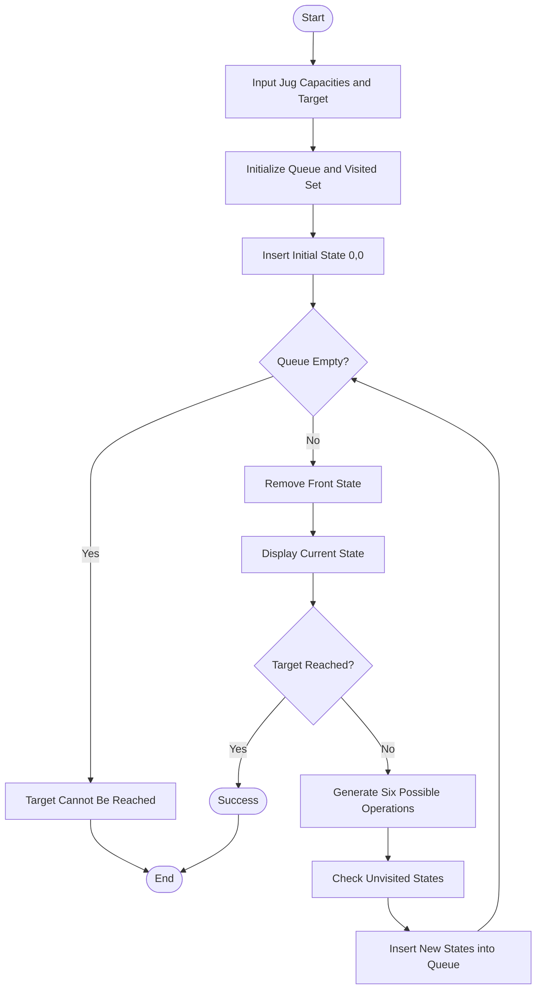

# Problem 1: Water Jug Problem

## 1. Problem Statement

The Water Jug Problem is a classic Artificial Intelligence problem in which two jugs of different capacities are given. The objective is to measure a specific target amount of water using the available operations.

The jugs can be filled, emptied, or water can be transferred from one jug to another.

## 2. Objective

- Represent the water levels of both jugs as states.
- Generate possible states using valid operations.
- Use Breadth-First Search (BFS) to explore states.
- Avoid revisiting already explored states.
- Find whether the target amount can be reached.

## 3. Algorithm Used: Breadth-First Search (BFS)

BFS explores states level by level using a queue.

**Steps:**

1. Start with both jugs empty: (0, 0).
2. Insert the initial state into the queue and visited set.
3. Remove the front state from the queue.
4. Check whether either jug contains the target amount.
5. Generate six possible operations:
   - Fill Jug A.
   - Fill Jug B.
   - Empty Jug A.
   - Empty Jug B.
   - Pour water from Jug A into Jug B.
   - Pour water from Jug B into Jug A.
6. Add unvisited states to the queue.
7. Repeat until the target is reached or no states remain.

## 4. Algorithm Flowchart



## 5. Implementation

**Data Structures Used:**

- `queue<pair<int, int>> q` – Stores states of both jugs and follows FIFO order.
- `set<pair<int, int>> visited` – Stores visited states to avoid repetition.
- `pair<int, int>` – Represents the water levels in Jug A and Jug B.

**Operations Used:**

- Fill Jug A and Jug B.
- Empty Jug A and Jug B.
- Pour water from one jug into another.

## 6. How to Run

Compile the program:

```bash
g++ WaterJug.cpp -o WaterJug
```

Run the program:

```bash
./WaterJug
```

On Windows:

```bash
WaterJug.exe
```

## 7. Sample Input

```text
Enter Jug A capacity: 4
Enter Jug B capacity: 3
Enter target amount: 2
```

## 8. Sample Output

```text
Step 1: Jug A = 0, Jug B = 0
Step 2: Jug A = 4, Jug B = 0
Step 3: Jug A = 0, Jug B = 3
Step 4: Jug A = 4, Jug B = 3
Step 5: Jug A = 1, Jug B = 3
Step 6: Jug A = 3, Jug B = 0
Step 7: Jug A = 1, Jug B = 0
Step 8: Jug A = 3, Jug B = 3
Step 9: Jug A = 0, Jug B = 1
Step 10: Jug A = 4, Jug B = 2
Target reached!
```

## 9. Complexity Analysis

Let `a` be the capacity of Jug A and `b` be the capacity of Jug B.

- **Time Complexity:** O(a × b), as there are at most (a + 1) × (b + 1) possible states, with six operations per state.
- **Space Complexity:** O(a × b), for storing states in the queue and visited set.

## 10. Conclusion

The Water Jug Problem demonstrates the use of Breadth-First Search (BFS) in Artificial Intelligence. It explores possible states systematically using a queue and avoids repeated states using a visited set.

---

**Student:** Tushar Kharade  
**Roll Number:** IC-2k23-96  
**Subject:** Artificial Intelligence  
**Language:** C++
