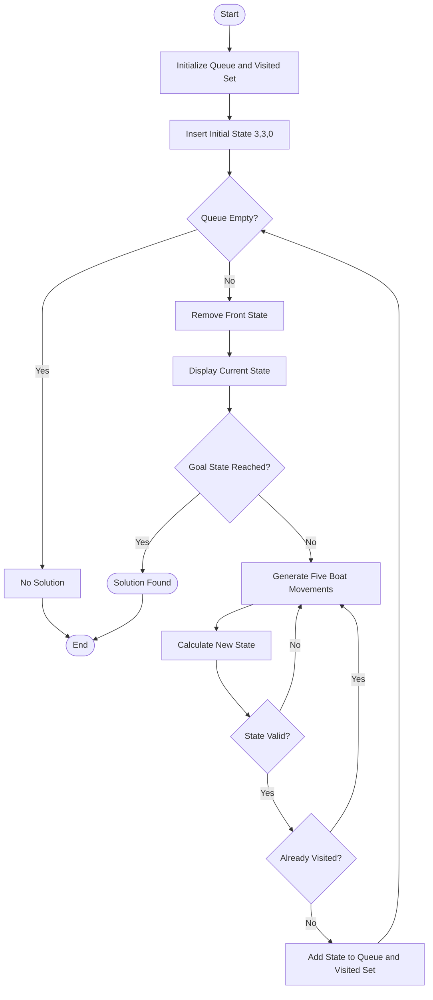

# Problem 2: Missionaries and Cannibals Problem

## 1. Problem Statement

The Missionaries and Cannibals Problem is a classic Artificial Intelligence problem. Three missionaries and three cannibals must cross a river using a boat that can carry a maximum of two people.

The number of cannibals must never exceed the number of missionaries on either riverbank when missionaries are present.

## 2. Objective

- Represent the river-crossing situation using states.
- Move missionaries and cannibals safely across the river.
- Ensure that cannibals never outnumber missionaries on either bank.
- Use Breadth-First Search (BFS) to find a valid solution.
- Avoid revisiting previously explored states.

## 3. Algorithm Used: Breadth-First Search (BFS)

BFS explores possible states level by level using a queue.

**Steps:**

1. Initialize the starting state as (3, 3, 0).
2. Insert the initial state into the queue and visited set.
3. Remove the front state from the queue.
4. Check whether all missionaries and cannibals have crossed the river.
5. Generate five possible boat movements:
   - One missionary.
   - Two missionaries.
   - One cannibal.
   - Two cannibals.
   - One missionary and one cannibal.
6. Calculate the new state based on the boat's position.
7. Check whether the new state is valid.
8. Add unvisited valid states to the queue.
9. Repeat until a solution is found or the queue becomes empty.

## 4. Algorithm Flowchart



## 5. Implementation

**Data Structures Used:**

- `queue<pair<pair<int, int>, int>> q` – Stores states and follows FIFO order.
- `set<pair<pair<int, int>, int>> visited` – Stores visited states to avoid repetition.
- `pair<pair<int, int>, int>` – Represents the number of missionaries, cannibals, and boat position.

**State Representation:**

`(M, C, Boat)`

- `M` – Missionaries on the left bank.
- `C` – Cannibals on the left bank.
- `Boat = 0` – Boat is on the left bank.
- `Boat = 1` – Boat is on the right bank.

**Validations:**

- Neither bank can have more cannibals than missionaries when missionaries are present.
- The number of missionaries and cannibals must remain between 0 and 3.
- Only the five defined boat movements are allowed.

## 6. How to Run

Compile the program:

```bash
g++ MissionariesAndCannibalsProblem.cpp -o MissionariesAndCannibalsProblem
```

Run the program:

```bash
./MissionariesAndCannibalsProblem
```

On Windows:

```bash
MissionariesAndCannibalsProblem.exe
```

## 7. Sample Input

No input is required. The program starts with a predefined initial state:

```text
(3, 3, 0)
```

## 8. Sample Output

```text
(3, 3, 0)
(3, 2, 1)
(3, 1, 1)
(2, 2, 1)
(3, 0, 1)
(3, 2, 0)
(3, 1, 0)
(1, 1, 1)
(2, 2, 0)
(0, 2, 1)
(0, 3, 0)
(0, 1, 1)
(0, 2, 0)
(0, 0, 1)
Solution found!
```

## 9. Complexity Analysis

There are at most 4 × 4 × 2 = 32 possible states.

- **Time Complexity:** O(1) for this fixed-size problem, as the number of possible states and movements is bounded.
- **Space Complexity:** O(1) for this fixed-size problem, as the queue and visited set store a bounded number of states.

## 10. Conclusion

The Missionaries and Cannibals Problem demonstrates the use of Breadth-First Search (BFS) in Artificial Intelligence. It uses state-space representation, valid-state checking, and a visited set to find a safe river-crossing solution.

---

**Student:** Tushar Kharade  
**Roll Number:** IC-2k23-96  
**Subject:** Artificial Intelligence  
**Language:** C++
