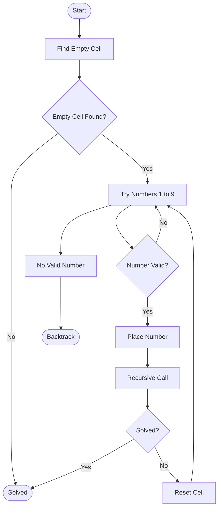

# Problem 3: Sudoku Solver (9×9)

## 1. Problem Statement

Sudoku is a logic-based puzzle consisting of a 9×9 grid divided into nine 3×3 subgrids.

The objective is to fill all empty cells (represented by `0`) with digits from 1 to 9 while satisfying the following rules:

- Each row must contain digits 1–9 without repetition.
- Each column must contain digits 1–9 without repetition.
- Each 3×3 subgrid must contain digits 1–9 without repetition.

## 2. Objective

- Represent the Sudoku puzzle using a 9×9 grid.
- Identify empty cells.
- Check whether a number can be placed in a particular cell.
- Solve the puzzle using recursive backtracking.
- Display the completed Sudoku grid.

## 3. Algorithm Used: Backtracking

Backtracking is a recursive problem-solving technique that tries possible solutions and reverses a choice when it leads to an invalid result.

### Steps:

1. Find an empty cell in the Sudoku grid.
2. If no empty cell exists, the puzzle is solved.
3. Try numbers from 1 to 9.
4. Check whether the selected number satisfies all Sudoku rules.
5. If valid, place the number and recursively solve the remaining grid.
6. If the recursive call fails, reset the cell to `0`.
7. Try another number until a solution is found.

## 4. Algorithm Flowchart



## 5. Implementation

The Sudoku grid is represented using a two-dimensional array:

```cpp
int grid[9][9];
```

Empty cells are represented by `0`.

The algorithm uses the following operations:

- **Find Empty Cell:** Finds the next unassigned position.
- **Check Validity:** Checks row, column and 3×3 subgrid constraints.
- **Solve Sudoku:** Uses recursion to fill empty cells.
- **Backtracking:** Resets an incorrect assignment and tries another number.

## 6. How to Run

Compile the program:

```bash
g++ Sudoku.cpp -o Sudoku
```

Execute:

```bash
./Sudoku
```

On Windows:

```bash
Sudoku.exe
```

## 7. Sample Input

```text
5 3 0 0 7 0 0 0 0
6 0 0 1 9 5 0 0 0
0 9 8 0 0 0 0 6 0
8 0 0 0 6 0 0 0 3
4 0 0 8 0 3 0 0 1
7 0 0 0 2 0 0 0 6
0 6 0 0 0 0 2 8 0
0 0 0 4 1 9 0 0 5
0 0 0 0 8 0 0 7 9
```

## 8. Sample Output

```text
5 3 4 | 6 7 8 | 9 1 2
6 7 2 | 1 9 5 | 3 4 8
1 9 8 | 3 4 2 | 5 6 7
------+-------+------
8 5 9 | 7 6 1 | 4 2 3
4 2 6 | 8 5 3 | 7 9 1
7 1 3 | 9 2 4 | 8 5 6
------+-------+------
9 6 1 | 5 3 7 | 2 8 4
2 8 7 | 4 1 9 | 6 3 5
3 4 5 | 2 8 6 | 1 7 9
```

## 9. Complexity Analysis

- **Time Complexity:** O(9^M), where M is the number of empty cells.
- **Space Complexity:** O(M), due to the recursive call stack.

## 10. Conclusion

The Sudoku Solver demonstrates how recursive backtracking can solve a Constraint Satisfaction Problem by exploring possible values and reversing invalid choices.

---

**Student:** Tushar Kharade  
**Roll Number:** IC-2k23-96  
**Subject:** Artificial Intelligence  
**Language:** C++
